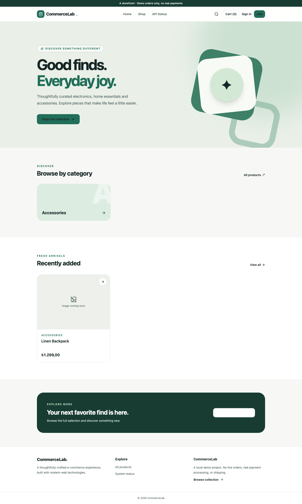
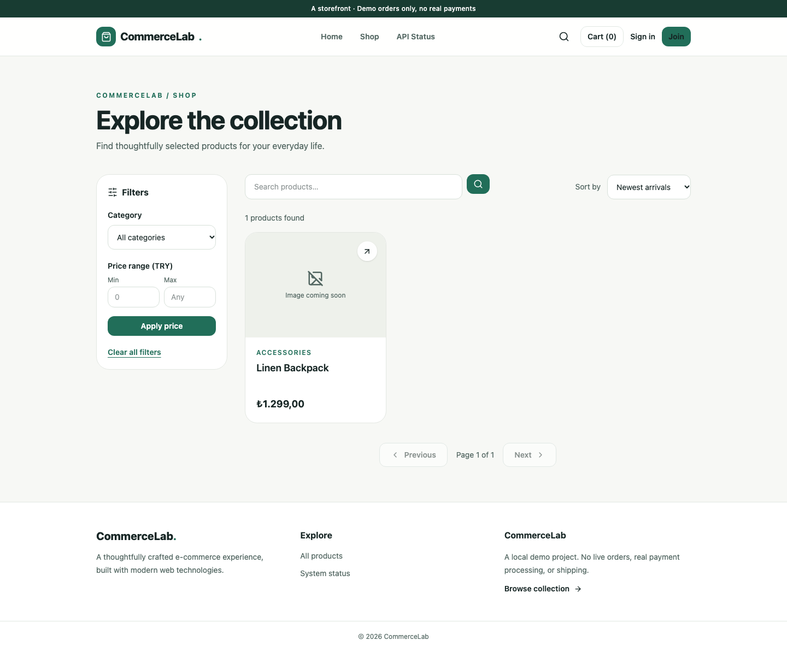
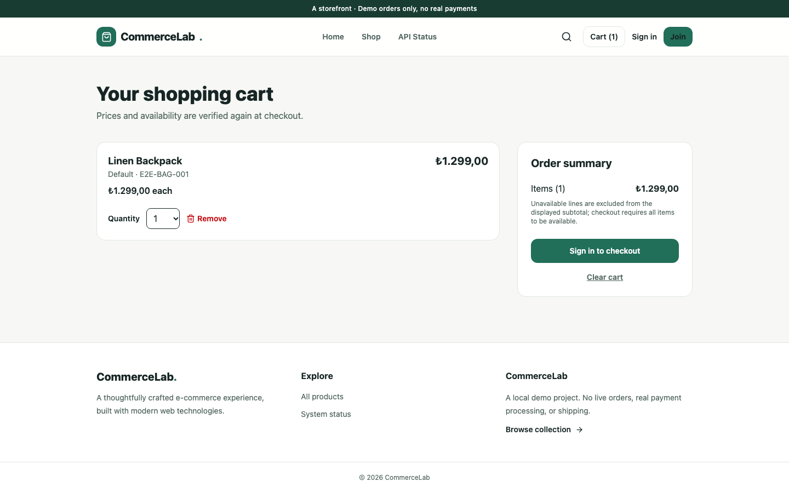
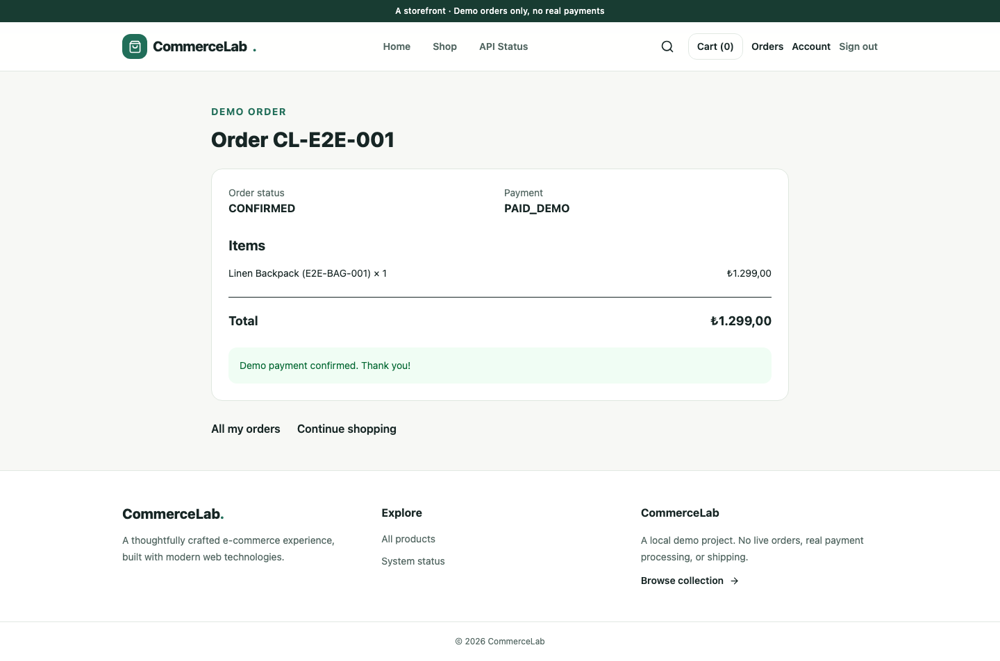
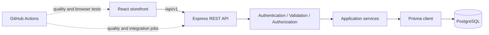

# CommerceLab

**Local-first full-stack e-commerce application** built to demonstrate production-minded engineering practices across a React storefront, a Node.js REST API, and PostgreSQL.

CommerceLab is a **portfolio / learning project**, not a deployed commercial store. Payments are simulated; **do not enter real card details**. The repository focuses on a realistic customer journey, a maintainable architecture, database consistency, security controls, and automated quality checks.

<!-- EC-016.3 SHOWCASE START -->
## Storefront showcase

Screenshots of the **real React interface**, captured using Playwright with **synthetic mock API data**. No real payments, accounts, or production data are used. [View the complete walkthrough](docs/showcase.md).

| Storefront | Product catalog |
| --- | --- |
|  |  |
| **Shopping cart** | **Demo order confirmation** |
|  |  |

<!-- EC-016.3 SHOWCASE END -->

## Features

- **Storefront:** category browsing, product listing and detail pages, product variants, and availability-aware catalog responses.
- **Authentication:** registration, sign-in, authenticated account flow, and session/refresh-token handling.
- **Cart:** guest and authenticated carts with merge behavior, quantity updates, and server-side validation.
- **Checkout:** authenticated checkout, idempotency key handling, transactional order creation, inventory checks, and server-calculated totals.
- **Orders:** order history and order details, a simulated payment flow, and administrator-facing order management API endpoints.
- **Security and observability:** authorization rules, CSRF protection for mutations, rate limiting, HTTP security headers, structured logs, and request IDs.
- **Quality:** unit/component tests, isolated PostgreSQL integration tests, browser end-to-end tests, and a two-job GitHub Actions CI pipeline.

> **Scope:** This is a single-store, TRY-based application with demo product data. The project does not perform real payment processing and its Docker setup is designed for **development**, not production deployment.

## Technology

| Area | Technologies |
| --- | --- |
| Web | React 19, TypeScript, Vite, React Router, TanStack Query, Tailwind CSS, React Hook Form, Zod |
| API | Node.js, Express 5, TypeScript, Zod, OpenAPI / Swagger UI |
| Data | PostgreSQL 17, Prisma 7, PostgreSQL adapter |
| Auth / security | HttpOnly cookie-based session flow, JWT, Argon2, CSRF, Helmet, rate limiting |
| Tests | Vitest, React Testing Library, Supertest, Playwright |
| Tooling | pnpm workspaces, Docker Compose, GitHub Actions, ESLint, Prettier |

## Architecture at a glance



The web application uses the Vite development proxy for `/api` requests. API controllers/routes validate incoming requests, and application services own business rules and database operations. See [`docs/architecture.md`](docs/architecture.md) and [`docs/database.md`](docs/database.md) for detailed notes (see also [`docs/api.md`](docs/api.md)).

## Requirements

- **Node.js 22** and **pnpm 10**, matching the development containers and CI baseline.
- Docker Desktop with Docker Compose v2 for the recommended local Docker workflow.
- Free host ports **3000** (API), **5173** (Web), and **5433** (development PostgreSQL).

> Do not run native `pnpm dev` and the full-stack Docker development environment simultaneously; both expect ports 3000 and 5173.

## Getting started (Docker development)

These steps use a **dedicated CommerceLab development database**. Do not reuse a production database or change credentials for an existing PostgreSQL volume.

1. Clone the repository and install/configure Docker Desktop.
2. On a **fresh installation**, copy `docker/.env.example` to `docker/.env` and replace its password placeholder with a strong local password. On an existing installation, **keep the existing `docker/.env`**; do not rotate it just to follow this guide.
3. From the repository root, start the API, Web, and PostgreSQL:

```bash
bash scripts/ec015-2-dev-stack.sh up
```

4. Check the Prisma migration history and the demo catalog before attempting changes:

```bash
node scripts/ec015-4-db.mjs status
```

If this is a **new, dedicated and empty** CommerceLab development database, inspect the pending migration SQL, then explicitly prepare it:

```bash
node scripts/ec015-4-db.mjs prepare --confirm-dev
node scripts/ec015-4-db.mjs verify
```

On a previously initialized database with zero pending migrations and an intact seed, skip `prepare`.

5. Verify the running application:

```bash
bash scripts/ec015-2-dev-stack.sh smoke
node scripts/ec015-7-infrastructure.mjs local
```

Open **http://127.0.0.1:5173** for the storefront, **http://127.0.0.1:3000/api/v1/health/ready** for API readiness, or **http://127.0.0.1:3000/api-docs** for non-production API documentation.

To inspect or stop the app containers without deleting PostgreSQL data:

```bash
bash scripts/ec015-2-dev-stack.sh ps
bash scripts/ec015-2-dev-stack.sh logs
bash scripts/ec015-2-dev-stack.sh down
```

**Never use** `docker compose down -v` or `prisma migrate reset` against your existing development data.

## Native development (alternative)

A native API/Web workflow remains available. PostgreSQL can run separately through `docker/compose.dev.yml`. Configure a private `apps/api/.env` from `apps/api/.env.example` with the local PostgreSQL URL, appropriate auth secrets (at least 32 unpredictable characters each), and the frontend origin. Never commit `.env` files.

```bash
pnpm install --frozen-lockfile
pnpm dev
```

The native Web server uses http://127.0.0.1:5173 and proxies `/api` to the native API at http://127.0.0.1:3000. Prepare the database separately using the dedicated migration script. Refer to the Docker or environment guide if you are switching from containerized to native development.

## Checks and CI

```bash
pnpm lint
pnpm typecheck
pnpm build
bash scripts/ec014-6-quality-regression.sh --check
node scripts/ec015-3-env-audit.mjs --templates
node scripts/ec015-8-final.mjs verify
```

`ec014-6-quality-regression.sh --check` runs the fast quality gate, including API/Web coverage and **six mocked browser E2E journeys**. The separate CI PostgreSQL job uses a **temporary PostgreSQL 17 service** to run **42 real-database integration tests**. This CI setup intentionally does not connect to the developer's local database.

For an additional clean-checkout regression on committed code:

```bash
node scripts/ec015-8-final.mjs clean
```

The clean check requires pnpm 10 and a clean Git worktree; it exports `HEAD` into a temporary directory instead of modifying your existing dependencies or Docker volumes.

## Repository layout

```text
apps/
  api/                 # Express API, Prisma schema/migrations, OpenAPI spec, tests
  web/                 # React storefront, feature modules, routes, E2E tests
docker/                # Development Compose files and Dockerfile
scripts/               # Database guards, smoke checks, CI and quality tools
docs/                  # Architecture and database documentation
.github/workflows/     # Quality + isolated PostgreSQL CI
```

## API documentation

The OpenAPI source lives in [`apps/api/docs/openapi/openapi.yaml`](apps/api/docs/openapi/openapi.yaml). Swagger UI is available at `/api-docs` in non-production mode, with interactive submission disabled. The REST API is mounted under `/api/v1`.

## Security and project boundaries

- Development credentials belong in private `.env` files; tracked `.env.example` files contain only placeholders.
- The checkout/payment path uses **simulated payments**. No real payment gateway or card-data capture is implemented.
- The Docker Compose setup is **for development** and is not a public production deployment recipe.
- Migration and seed operations are deliberately separate from container startup. Preserve applied migrations and existing database volumes.
- Refer to the implementation and OpenAPI source for authoritative behavior.

## Portfolio roadmap

- [x] Core storefront and API flows
- [x] Authentication, cart, checkout, and order workflows
- [x] Security/performance and automated testing phases
- [x] Docker development workflow and CI quality/integration jobs
- [x] Final architecture, database, and API documentation refresh (EC-016)
- [x] Curated screenshots, walkthrough, and portfolio presentation (EC-016)

---

**Purpose:** demonstrate end-to-end software delivery and thoughtful engineering trade-offs in a learning/portfolio project.
