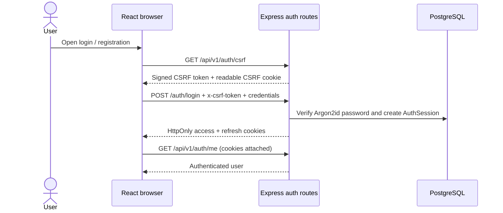
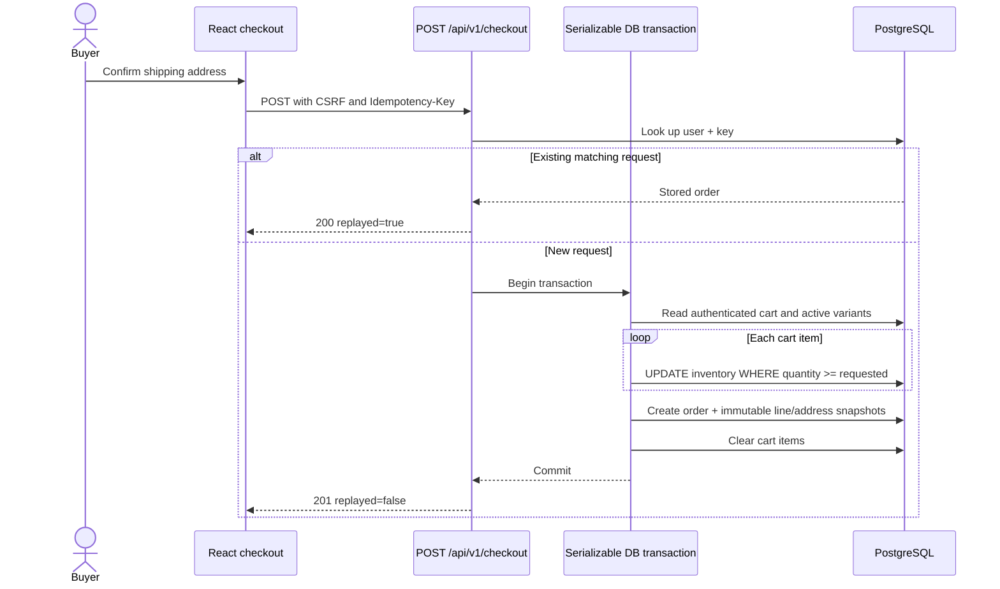

# CommerceLab — System Architecture

> **Scope:** local-first learning/portfolio application. This describes the checked-in React/Express/Prisma implementation; the Docker Compose stack is a **development** setup, not a production deployment architecture. See [Database design](database.md) and [API contract](api.md).

## Architectural overview

```mermaid
flowchart LR
    Browser[Browser / React 19] -->|React Router| Pages[Lazy-loaded pages]
    Pages --> Client[Feature hooks / TanStack Query]
    Client -->|same-origin /api/v1| Vite[Vite proxy in development]
    Vite --> Express[Express 5 REST API]
    Express --> Http[Helmet / CORS / cookies / request IDs]
    Http --> Routes[Routes / validation / auth / CSRF]
    Routes --> Services[Services: business rules]
    Services --> Repos[Repositories / Prisma transactions]
    Repos --> DB[(PostgreSQL 17)]
    CI[GitHub Actions] -.->|quality + mock browser tests| Browser
    CI -.->|isolated DB integration tests| DB
```

The browser makes relative `/api/...` requests with `credentials: "include"`. During development, Vite proxies `/api` to the Express API; Docker uses service networking. Express mounts the API under `/api/v1`, and exposes non-production Swagger UI under `/api-docs` (read-only request submission). The API returns a JSON envelope (`success`, `data` for successes; `success: false` for errors).

## Responsibility boundaries

| Layer | Location | Responsibilities |
| --- | --- | --- |
| UI routing and views | `apps/web/src/App.tsx`, `pages/` | React Router navigation, lazy loading, protected screens |
| Client state and HTTP | `apps/web/src/features/`, `lib/api-client.ts`, `lib/query-client.ts` | Feature hooks, server cache, cookie-bearing API calls, CSRF header for writes |
| HTTP and middleware | `apps/api/src/app.ts`, `routes/`, `middlewares/` | Routing, input validation, CSRF/auth/role checks, error translation, request IDs |
| Domain services | `apps/api/src/services/` | Authentication, cart, catalog, checkout, order state transitions |
| Persistence | `apps/api/src/repositories/`, `config/database.ts` | Prisma queries, serializable transactions, PostgreSQL adapter |
| Schema and migration source | `apps/api/prisma/` | Models, relationships, raw SQL constraints and applied migration history |
| API contract | `apps/api/docs/openapi/openapi.yaml` | OpenAPI 3.1 paths, parameters and request metadata; schema detail is not yet exhaustive |

**No separate controller classes are required:** current route handlers handle the HTTP boundary and delegate to services. Do not describe a controller layer that is not in the code.

## Authentication and CSRF

- User passwords use Argon2id; access tokens and refresh sessions are different mechanisms. Refresh tokens are hashed in `AuthSession`, rotated on refresh, and can be revoked per session or for all sessions.
- CSRF checks require the signed cookie/header pair; the middleware also rejects explicit cross-site fetches and mismatched `Origin`. The browser API helper obtains the token before mutations.
- Production cookie names/security attributes differ from localhost development. CORS credentials are restricted to the configured frontend origin; Helmet headers and rate limiting protect relevant routes.
- Authorization remains server-side: `requireAuth` and `requireRole("ADMIN")` protect privileged routes. Do not rely on React route guards as authorization.

## Guest cart and merge

Guest carts use a cookie-derived, hashed identity; authenticated carts are tied to a user. Cart services validate product status, variant activity, stock and quantity limits before writes. A post-login `POST /cart/merge` combines guest items into the user cart inside a serializable transaction; if validation fails, the original carts remain intact and the guest cookie is not cleared.

## Checkout, idempotency and payment demo

- Checkout requires authentication, a CSRF token and a 16–100-character URL-safe `Idempotency-Key`. The database enforces uniqueness on `(userId, idempotencyKey)`; the implementation compares a hash of the shipping-address input for replays and returns `409` on a different request with the same key.
- Server-side totals use Prisma `Decimal` and live catalog prices; client-provided prices are not accepted. The current demo uses TRY and zero shipping.
- Stock is **decremented**, not merely reserved, using conditional updates (`quantity >= requested quantity`) inside a serializable transaction. Failed transactions roll back all changes. Order lines and the shipping address are snapshotted.
- Order transactions retry PostgreSQL/Prisma serialization conflicts (`P2034`) up to three attempts. Payment is a **simulation**, without payment card collection or an external gateway.
- Demo payment success marks a pending order confirmed/paid. Demo failure cancels and restores stock. Eligible administrator cancellations also restore stock and may mark a simulated refund.

## Lifecycle, operations and quality

- `GET /api/v1/health/live` indicates the process is responding. `GET /api/v1/health/ready` executes `SELECT 1`, returning **503** if PostgreSQL is unavailable.
- Docker development: PostgreSQL 17 on host `127.0.0.1:5433`; API `127.0.0.1:3000`; Web `127.0.0.1:5173`. The full-stack overlay starts API/Web only after healthy prerequisites; development data stays in the named volume.
- Database initialization is **explicit** and separate from container startup. Never infer that running Docker automatically applies migrations or seed data.
- The GitHub Actions quality job covers lint, types, builds, coverage and six mocked Playwright flows; the separate PostgreSQL job uses temporary test databases for 42 integration cases. Avoid running destructive test setup against `commercelab_dev`.

## Deliberate limits / follow-up work

This application demonstrates engineering decisions rather than operating a production store. No actual payment processing, production cloud deployment, customer notifications, stock reservations ledger, or monitoring service is claimed. End-to-end authorization and DB safeguards are implemented in code/tests, but diagrams are explanatory and do not replace their verification.
