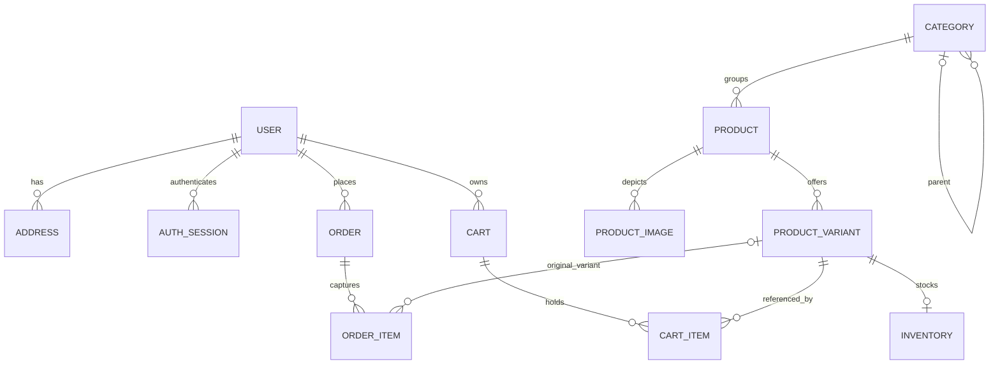

# CommerceLab — Database Design

> **Source of truth:** [`apps/api/prisma/schema.prisma`](../apps/api/prisma/schema.prisma) plus the SQL in [`apps/api/prisma/migrations`](../apps/api/prisma/migrations). Prisma does **not** represent every PostgreSQL `CHECK` constraint or partial unique index. See [architecture](architecture.md) and [API contract](api.md).

## Scope and models

The application uses one PostgreSQL database for a single-store TRY demo. The current Prisma schema defines **12 models**: `User`, `Address`, `Category`, `Product`, `ProductImage`, `ProductVariant`, `Inventory`, `Cart`, `CartItem`, `Order`, `OrderItem`, and `AuthSession`.



`AUTH_SESSION` in the diagram corresponds to the Prisma model `AuthSession`; the relationship from an `OrderItem` to a `ProductVariant` is optional so order history can survive variant removal where allowed. Product and category relationships use restrictive deletion for integrity; the administration API **archives** products rather than permanently deleting them.

## Modeling and consistency decisions

| Concern | Design |
| --- | --- |
| Money | `Decimal(12,2)` for prices/totals; server computes checkout totals using Prisma `Decimal` and formats monetary API amounts as decimal strings |
| Category / catalog | Unique category and product slugs, unique variant SKU, publication status (`DRAFT`, `ACTIVE`, `ARCHIVED`) |
| Inventory | One optional inventory row per variant in schema (`variantId` unique); conditional stock decrements prevent oversell during checkout |
| Cart ownership | Exactly one owner: authenticated `userId` **or** `guestTokenHash`; partial unique index permits one persisted user cart |
| Cart items | Unique `(cartId, variantId)` plus positive quantity constraint |
| Order snapshots | Name, SKU, unit price and shipping address stored on order records independent of later product edits |
| Checkout deduplication | Unique `(userId, idempotencyKey)` on `Order` and a request fingerprint for replay consistency |
| Authentication | Refresh token hashes and previous-hash rotation metadata stored in `AuthSession`; no raw refresh token stored in DB |

The schema alone does not guarantee “every active product has a sellable variant” or prevent category-parent cycles. Those are separate application rules or potential improvements.

## Transaction invariants

1. **Checkout:** within one `Serializable` transaction, read the user's cart, check active variants and TRY currency, conditionally decrement inventory where sufficient stock remains, create `Order`/`OrderItem` snapshots, and clear cart items. On failure, no partial order or stock movement commits.
2. **Idempotency:** repeat of the same `(userId, idempotencyKey)` and shipping-address payload reuses the existing order. Reuse with a different fingerprint returns `409`; concurrently inserted duplicate keys are handled after the database unique constraint fires.
3. **Demo payment and cancellation:** permitted state transitions occur in transactions. Failure/cancellation restocks each item; unavailable variant/inventory results in an error requiring manual investigation rather than silent stock corruption.
4. **Cart:** guest/user operations and merge use serializable transactions with bounded retries. Merge validates the combined item quantities and availability before deleting the guest cart.

The current order status enumeration includes `PENDING`, `CONFIRMED`, `PROCESSING`, `SHIPPED`, `DELIVERED`, `CANCELLED`; payment status includes `UNPAID`, `PAID_DEMO`, `REFUNDED_DEMO`.

## Applied migration history

The repository snapshot examined for EC-016.2 contains **seven migration folders**, matching the user's previously reported **7 applied / 0 pending** local development state:

| Migration | Purpose |
| --- | --- |
| `20261117000000_baseline_schema` | Full initial schema for fresh installs; **existing initialized DBs may need a baseline record rather than replaying table creation** |
| `20261117135558_init_ecommerce` | Raw SQL integrity constraints and partial user-cart uniqueness index (despite its historical name) |
| `20261118110000_auth_sessions` | Persisted hashed refresh-token sessions |
| `20261118170000_cart_integrity` | Ensure one cart owner, positive item quantities and user cart uniqueness |
| `20261118190000_checkout_idempotency` | `Order` idempotency key, fingerprint and unique user/key index |
| `20261119150000_restore_missing_checks` | Repair missing integrity constraints in already-provisioned development DBs |
| `20261119160000_refresh_reuse_tracking` | Previous refresh-hash and rotation timestamp for replay detection |

**Important:** Migration folders are immutable history. The baseline behavior depends on whether a database already contains tables, so do not apply baseline SQL indiscriminately or edit an applied migration. Do not use `prisma migrate reset` on the existing local development database.

## Development database operations

The EC-015 guard script checks the exact Docker Compose project, PostgreSQL role/database, migration history and catalog records. Use it **from the repository root**:

```bash
node scripts/ec015-4-db.mjs status   # read-only
node scripts/ec015-4-db.mjs verify   # read-only
```

On a **new and dedicated** empty development database only, after reviewing pending migrations and taking a backup if needed:

```bash
node scripts/ec015-4-db.mjs prepare --confirm-dev
```

Seed upserts three demo catalog products and their variants; its inventory upsert does not overwrite existing stock quantities. It may update demo catalog metadata/prices, so it should never be run against real customer-managed catalog data.

## Test isolation and limits

- Local development uses `commercelab_dev` in the `commerce-lab-dev` Compose project, exposed on host port `5433`.
- Existing isolated integration suites target **`commercelab_authz_test`** and **`commercelab_checkout_test`**; CI provisions a temporary PostgreSQL 17 service rather than connecting to development data.
- `CHECK` constraints, raw SQL indexes, transactions and cancellation rollback paths are verified by integration tests; the ER diagram alone does not enforce invariants.
- Future enhancements might include inventory reservations, stock movement audits, category-cycle protection and hardening active-product variant requirements.
