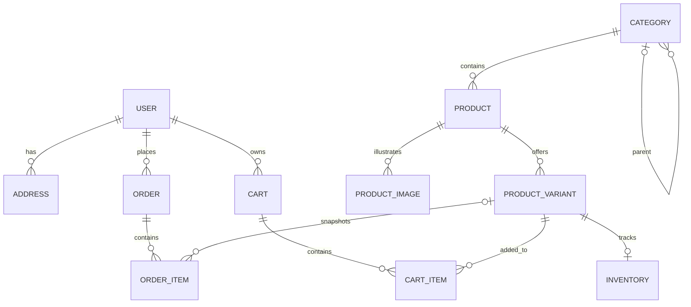

# CommerceLab — Database Design

## Scope

Single-store, TRY-only MVP. Models: `User`, `Address`, `Category`, `Product`, `ProductImage`, `ProductVariant`, `Inventory`, `Cart`, `CartItem`, `Order`, `OrderItem`.

## Architecture decisions

- Every sellable product must have at least one variant; application logic creates a default variant where needed. This invariant is **not** enforced by the relational schema.
- Product variants own their `sku`, price and currency. `sku` is unique; products and categories have unique slugs.
- Store prices using PostgreSQL `DECIMAL(12,2)` and Prisma `Decimal`; never use JavaScript floating-point arithmetic for checkout totals.
- Snapshot product name, SKU, unit price and delivery address into each order. Archive products by default; do not destructively remove records needed by historical orders.
- A cart item identifies one product variant and a quantity. `@@unique([cartId, variantId])` prevents duplicate lines.
- A cart belongs **either** to a registered user **or** to a guest token, but not both. The second migration adds a database `CHECK` constraint for this, and a partial unique index allowing at most one cart per registered user. The existing unique guest-token index is retained.
- Inventory quantities and amounts must be nonnegative; cart/order quantities must be positive. The second migration enforces these as PostgreSQL `CHECK` constraints. Prisma schema files do not represent these custom checks and partial indexes directly; **preserve the migration history**.
- Checkout remains to be implemented: use a database transaction and conditionally decrement stock only where `quantity >= requestedQuantity`, check affected row counts, then create the order. The nonnegative check alone **does not** prevent overselling or guarantee atomic order creation.
- Checkout recalculates prices and availability on the server. Orders require authentication. Payment is simulated; never collect payment-card data.
- Category parent relationships are self-referencing with restrictive deletes. Application code will still need to prevent category cycles.
- Product variant/inventory foreign keys and order history deliberately restrict destructive deletes. Products should be archived rather than hard deleted.
- All examples use localhost PostgreSQL port `5433` to avoid conflicts with DevFlow's default `5432`.
- Seed upserts three categories and three demo products. It does not reset stock on repeated runs. It **does** update demo product names/prices on repeat; avoid using seed against real customer-managed catalog data.

## Entity relationships

## Migration history

1. `20261117135558_init_ecommerce` — 11 tables, enum types, foreign keys, uniqueness and baseline indexes.
2. `20261117170000_integrity_constraints` — nonnegative stock/price checks; positive cart/order quantities; cart ownership check; one-cart-per-user partial unique index.

The second migration is raw SQL because Prisma schema does not model PostgreSQL `CHECK` constraints and partial indexes directly. Never edit the first migration once it has been applied. Run the new migration only on the dedicated CommerceLab development database and inspect any failure before retrying.

## Validation / release gates

1. `pnpm --filter @commercelab/api exec prisma migrate deploy` applies pending committed migration SQL.
2. `pnpm --filter @commercelab/api exec prisma migrate status` reports no pending migrations.
3. `pnpm --filter @commercelab/api exec prisma validate` and `prisma generate` pass.
4. `pnpm --filter @commercelab/api exec prisma db seed` succeeds twice without duplicate categories/products or resetting inventory.
5. Confirm constraints in PostgreSQL (`pg_constraint`) and the unique cart index (`pg_indexes`).
6. Later, service/integration tests must prove concurrent checkout cannot oversell, totals and stock remain consistent on failure, and guest-to-user cart merge is correct.

## Deferred issues

- Preventing a category from becoming its own ancestor, including multi-node cycles.
- Enforcing at least one variant per active product and one inventory row per sellable variant.
- Deciding whether inventory needs reservations or stock movement audit records.
- Full-text catalog search, additional filtering indexes, money rounding/tax/shipping policies.
- Verifying application-level ownership authorization for carts, addresses, and orders.
