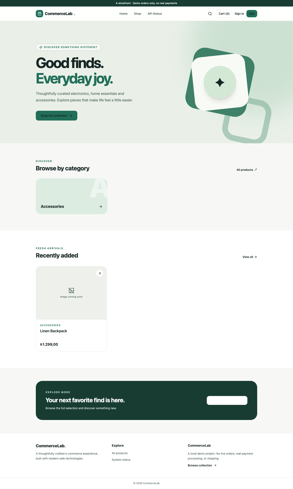
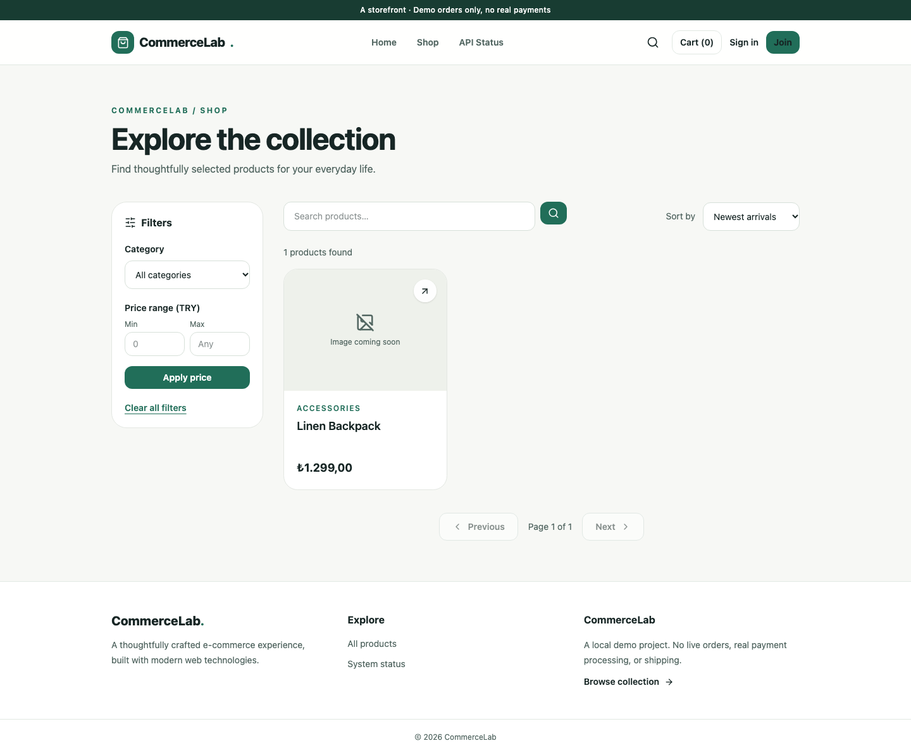
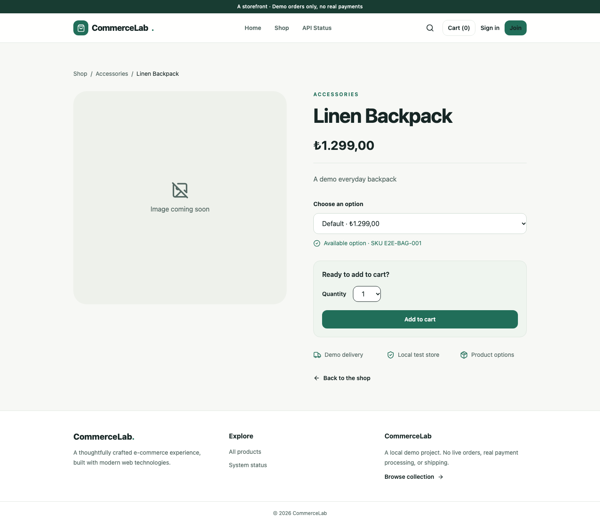
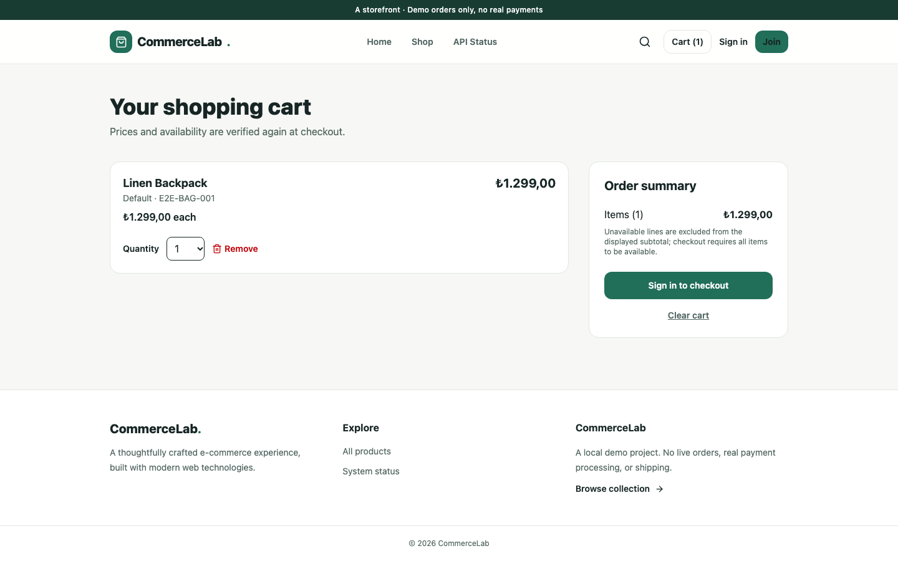
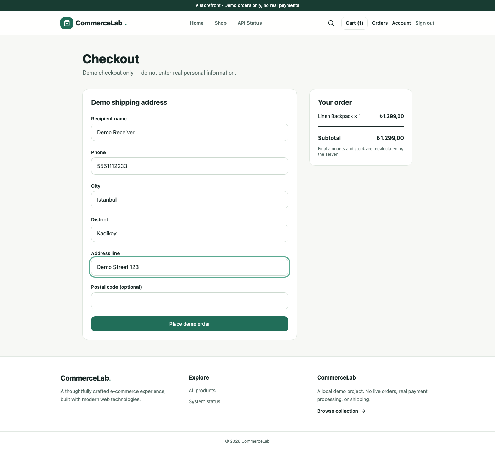
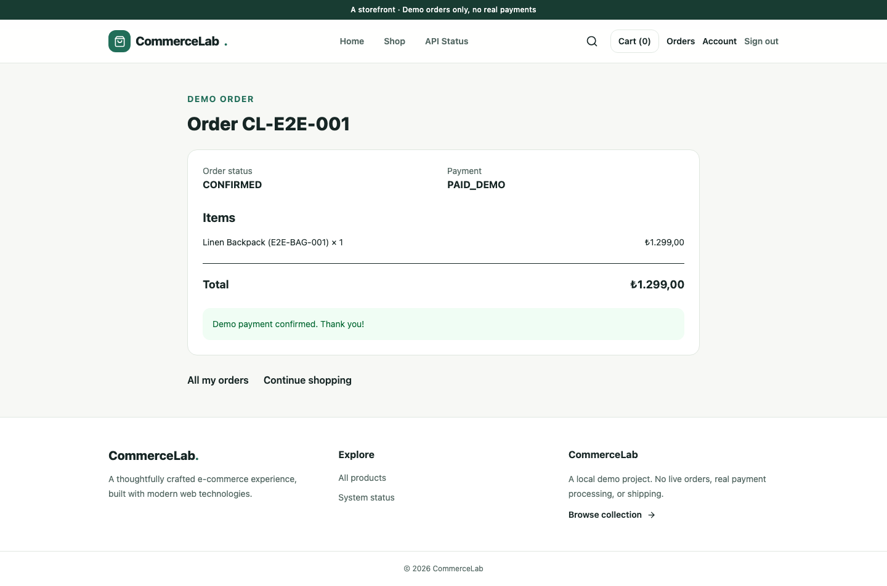
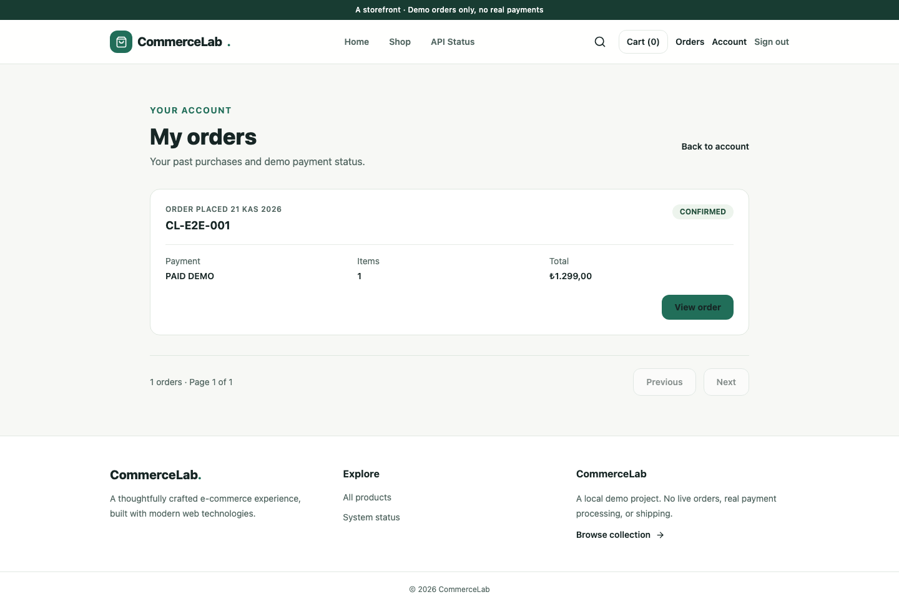
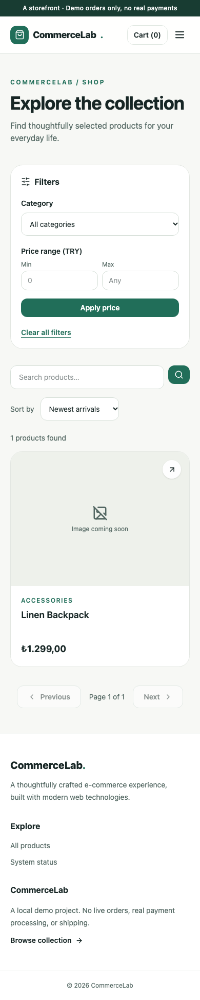

# CommerceLab — Product showcase

The screenshots in this document depict the **actual CommerceLab React interface**, exercised with a **deterministic, mocked API** in Playwright. Product names, accounts, addresses, and orders are synthetic. These are **not screenshots of a live production store** or proof of real payment processing. The captures do not read or modify the local PostgreSQL database.

## Storefront journey

### 1. Home — first impression



Landing page, primary navigation, categories, and featured catalog.

### 2. Product catalog — search and discovery



Product listing and discovery interface; the mocked catalog contains one sample item.

### 3. Product detail — variant and add-to-cart



Product information, the active variant, and a guest cart action.

### 4. Guest shopping cart



Guest cart and calculated demo subtotal before authentication.

### 5. Authenticated checkout



Demo shipping fields and checkout review using synthetic information. Server-side totals and idempotency are covered by the underlying application and tests; a screenshot alone does not verify those properties.

### 6. Demo payment result



Confirmed simulated payment. No real payment method is submitted or charged.

### 7. Order history



Order history displayed for the synthetic showcase account.

### 8. Mobile catalog



Responsive catalog on a 390-pixel viewport.

## Reproduce the screenshots

Run from the repository root with **pnpm 10**, Node.js 22, and Playwright Chromium installed:

```bash
pnpm --filter @commercelab/web exec playwright install chromium
pnpm --filter @commercelab/web exec playwright test --config playwright.showcase.config.ts
node scripts/ec016-3-showcase.mjs publish
node scripts/ec016-3-showcase.mjs verify
```

The dedicated showcase test starts Vite at `127.0.0.1:5191`; its Vite configuration intentionally disables forwarding to a real API; it does not need a backend, a running Docker stack, auth secrets, or database migrations. It imports the same API mock used by the existing browser E2E tests. It is deliberately excluded from the regular browser and live E2E configurations and does not change the CI test count.

Do not replace these files with screenshots of real accounts or data-bearing development databases. Review all eight screenshots visually before publishing them.

## Technical documentation

- [Architecture](architecture.md)
- [Database design](database.md)
- [API behavior](api.md)
- [OpenAPI source](../apps/api/docs/openapi/openapi.yaml)
